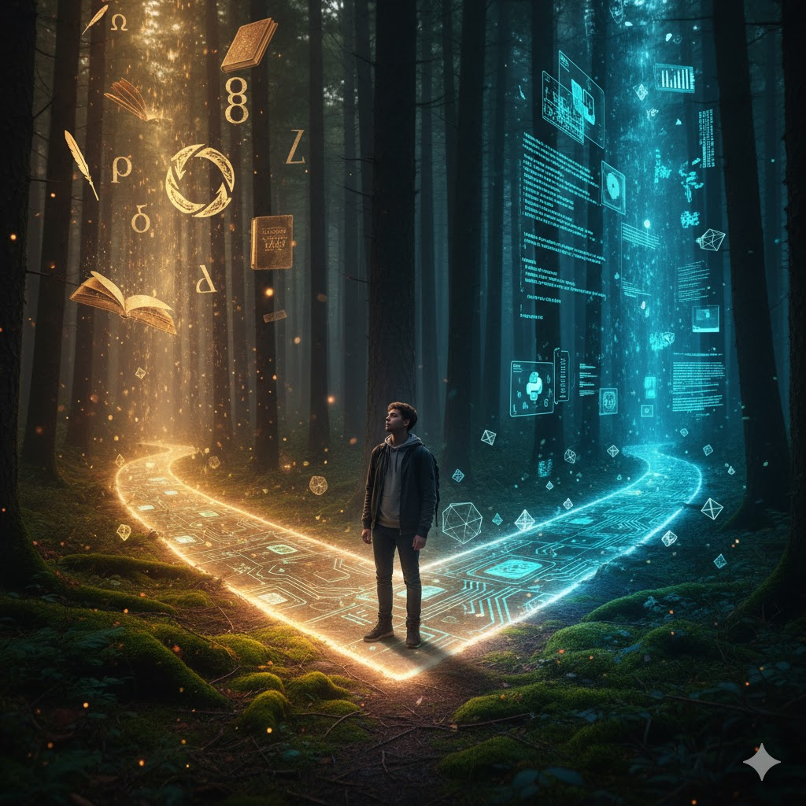

# The Symmetry of Choice: Why To Choose Is Also To Exclude

Deep within mathematics, in a field that counts and arranges things, lies an equation so simple it feels like a secret. It speaks not just of numbers, but of the very essence of decision, identity, and existence. It has haunted my thoughts for years, revealing new layers of meaning in my life, my work, and even in the artificial minds we are building.

The equation comes from combinatorics, and it looks like this:

$$\binom{n}{k} = \binom{n}{n-k}$$

Let's not get lost in the symbols. The meaning is what matters, and it is beautifully intuitive. It says that the number of ways to choose *k* items from a collection of *n* is exactly the same as the number of ways to *leave behind* the other *n-k* items.

Think about it. If you have ten books on a shelf and you choose three to take on a journey, you have also, in the very same action, chosen seven to leave on the shelf. The act of selecting is inseparable from the act of excluding. They are two sides of the same coin, a perfect and profound symmetry. This is not just a mathematical curiosity. It is a blueprint for understanding choice itself.

## The Ghost of a Thousand Other Lives

I remember standing in a university library, paralyzed by indecision. I had to choose a major. Would it be philosophy or computer science? To choose one felt like killing the other. Every path I imagined for myself, the life of a programmer building new worlds from logic, or the life of a thinker wrestling with ancient questions, was beautiful. But I could only walk down one. To say "yes" to code was to say "no" to Kant, at least in that formative, all consuming way.

This is the human weight of our equation. Every choice we make, from our partners to our careers to the city we call home, is also an act of profound exclusion. We are defined not just by the things we embrace, but by the infinite possibilities we let go. Our identity is a sculpture, and the artist’s tool is not just the clay it adds, but the stone it carves away. The ghosts of the lives we did not live are what give shape to the one we do. There is a quiet sadness in this, but also an incredible power. It makes our choices meaningful. They are not trivial, they are declarations of what matters to us, made against the backdrop of all that we must sacrifice.

## The Curated World of the Algorithm

This same principle now governs our digital lives, but with a chilling new scale and invisibility. When an AI recommendation engine suggests a movie, a song, or a news article, it is making a choice. It picks a tiny *k* from a practically infinite *n*. For every song you are shown, millions are left in silence. For every perspective you read, thousands are left in the digital dark.

This is the algorithm's act of exclusion. We experience its choice as a convenience, a curated reality. Yet, we rarely stop to consider the vast *n-k* world, the universe of ideas and art the AI has chosen for us *not* to see. An artificial intelligence trained to identify cats becomes an expert in what is "not a cat." Its entire reality is built upon this boundary. But when the data it is not shown contains certain types of faces, certain dialects, or certain inconvenient truths, the AI's exclusion becomes a form of bias. The "not chosen" data becomes a ghost in the machine, shaping its decisions in ways we can neither see nor predict. The act of choosing what data to use for training an AI is a monumental act of exclusion, with consequences that ripple out into the world.

## Finding Freedom in What We Are Not

What can this mathematical symmetry teach us? It teaches us that freedom is not about having limitless options. It is about the deliberate and conscious act of creating boundaries. We find ourselves not by trying to be everything, but by understanding and accepting what we are not.

To define a community is to know who is not in it. To hold a belief is to understand the beliefs you reject. To love someone is to not love countless others in that same way. Inclusion and exclusion are a single, unified dance.

The equation $\binom{n}{k} = \binom{n}{n-k}$ is more than a clever trick for counting. It is a mirror reflecting a fundamental truth. Every time you choose, you are performing an act of creation, carving a single reality from the marble of infinite potential. You are both the selector and the excluder. And in that dual role, in that perfect, elegant balance, lies the hidden and beautiful structure of a meaningful life.